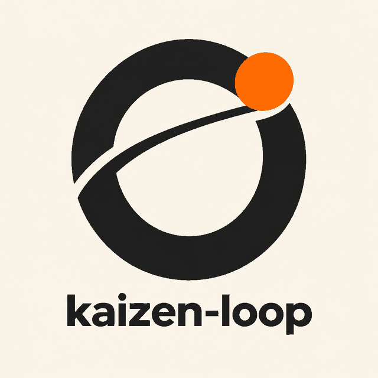
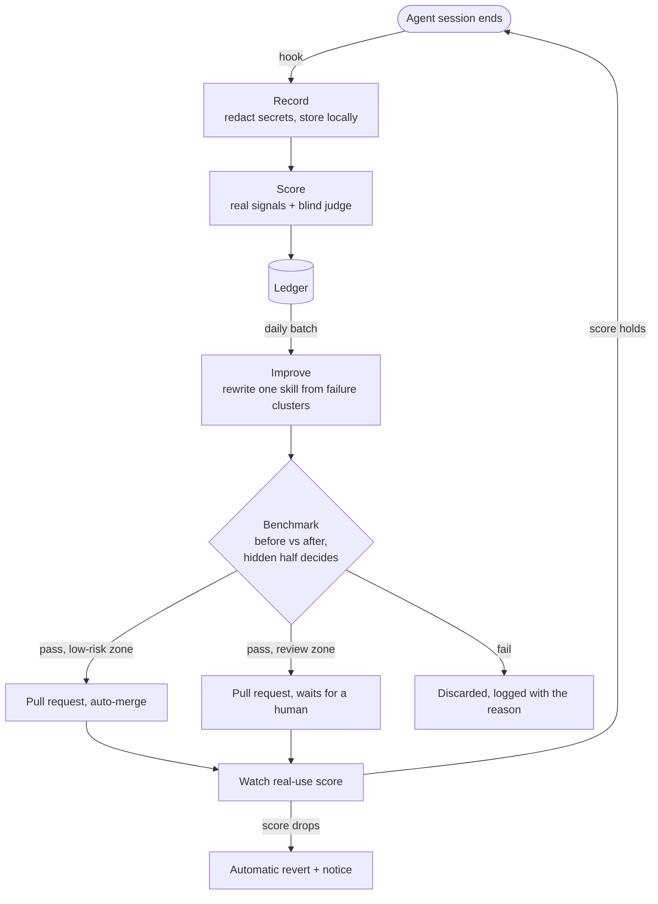
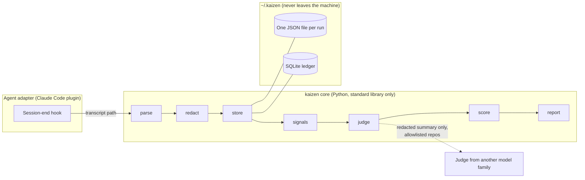

<p align="center">
  
</p>

<h1 align="center">kaizen-loop</h1>

<p align="center">
  See where your coding agent wastes effort, then improve its skills with changes proven on a benchmark.
</p>

<p align="center">
  
  
  
  
  
  
</p>

> [!WARNING]
> Nothing is usable yet. Stage 1 is being built. The commands and output shown below describe the design, not a release.

## Why

Coding agents repeat the same mistakes and waste the same tokens, because nothing they learn in one session reaches the next unless a person edits their skills by hand.

kaizen-loop closes that gap. It records each agent session, scores it against real signals (tests, pull request outcomes, measured waste), rewrites the agent's skills from that evidence, proves the rewrite on a fixed benchmark, and ships it through a pull request. Small local decision models take the bounded decisions (which model tier to use, what kind of failure this is) and improve from the same recorded outcomes.

## How it works



Every improvement carries a number: score before, score after, cost before, cost after.

## Principles

| Principle | What it means in practice |
|---|---|
| Evidence before change | A skill is rewritten only from recorded failures, and each proposal states a prediction that can be proven wrong. |
| Correctness is a gate | Failing tests cap the score. Cost and efficiency cannot buy back a wrong answer. |
| The loop cannot grade itself | Benchmark tasks, judge code and the policy file are off limits to the loop. |
| Private by default | Recordings stay on your machine with secrets removed. Nothing is uploaded unless you allow a repository by name. |
| It must pay for itself | A daily budget cap stops the loop, which then reports what it spent against what it saved. |

## Architecture

An agent-neutral Python core does the work. Each supported agent gets a thin adapter. Claude Code is the first.



| Module | Job |
|---|---|
| `record` | Turn an agent transcript into a neutral run record: tool calls, token usage, test commands, pull request links. |
| `redact` | Remove API keys, tokens, private keys and credentials before anything touches disk. |
| `store` | One JSON file per run plus a SQLite ledger under `~/.kaizen/`. |
| `signals` | Deterministic facts from a run: test results, re-reads of the same file, retried commands, tool errors. |
| `judge` | A blind rubric judge. It sees a summary packet with no model names, no repository name and no cost. |
| `score` | A 0–10 score: judged quality 40%, efficiency 30%, cost 30%, with correctness as a gate. |
| `report` | A plain-text report of where tokens go and which mistakes repeat. |

<details>
<summary><b>What the score is made of</b></summary>

<br>

- **Quality (40%)** comes from the blind judge, using a five-point rubric: did it do what was asked, did it verify its work, did it stay in scope, did it follow corrections, is the change clean and minimal.
- **Efficiency (30%)** measures waste against your own median: re-reads, retries and tool errors.
- **Cost (30%)** measures tokens against your own median.
- **Correctness** is not a term in the sum. If the last test run failed, the total is capped at 4.0.
- A run with no tests, no pull request and no user corrections is marked **weak** and is never used as evidence for an improvement.

The weights are configurable.

</details>

<details>
<summary><b>What the report will look like</b></summary>

<br>

```text
kaizen report — last 20 runs
Score: 6.4 avg  (strong: 12 runs, weak: 8)
Tokens: 1,240,000 total, 62,000 per run
Top waste
  re-reads   31   (src/app.py x9, README.md x4)
  retries    12
  tool errors 7
Lowest runs
  3.1  2026-11-19  api-server   tests failed at end
  4.0  2026-11-18  web-client   4 corrections from user
Repeated corrections
  "run the tests before saying done"  x3
```

Illustrative numbers from the design.

</details>

<details>
<summary><b>Planned commands</b></summary>

<br>

| Command | What it does |
|---|---|
| `kaizen record` | Parse, redact, store and score one session. |
| `kaizen import` | Record the sessions already on disk. |
| `kaizen score` | Run the judge for sessions that do not have a judged score yet. |
| `kaizen report` | Print the report. |
| `kaizen calibrate` | Grade a few runs yourself and see how often the judge agrees with you. |
| `kaizen audit` | Scan the local store for secrets. Exits non-zero on any hit. |
| `kaizen improve` | Propose and benchmark one skill change (stage 2). |
| `kaizen route` | Ask a local decision model which model tier a task needs (stage 3). |

</details>

## Roadmap

| Stage | What it delivers | Done when | Status |
|---|---|---|---|
| **1. Record and score** | Sessions captured locally with secrets redacted, scored from real signals plus a blind judge, shown in a CLI report. | 20 real sessions scored, zero secrets in the store (automated test), judge agrees with a human on at least 7 of 10 runs. | In progress |
| **2. Improvement loop** | One skill change at a time, gated on a benchmark with a hidden half, shipped by pull request with the before and after score, reverted automatically if real-use scores drop. | 3 merged improvements with a positive hidden-benchmark result, no wrong auto-merge, one revert drill that worked. | Planned |
| **3. Decision models** | Local open-source decision models route tasks and triage failures, chosen by benchmark. | Cost per verified solve is lower with the decision model on than with written rules. | Planned |

### Safety zones (stage 2)

Changes are sorted by path rules that the runner enforces, not the agent.

| Zone | Examples | What happens |
|---|---|---|
| Auto | Skill text, skill descriptions, decision thresholds | Merged automatically when the benchmark passes. |
| Review | Global agent instructions, permissions, hooks, anything touching secrets, deploy or git | Pull request waits for a human. |
| Forbidden | Benchmark tasks and answers, judge code, the policy file | The loop cannot propose changes. |

## Research

The literature and engineering review behind the design is in [docs/research](docs/research/README.md).

## License

MIT
