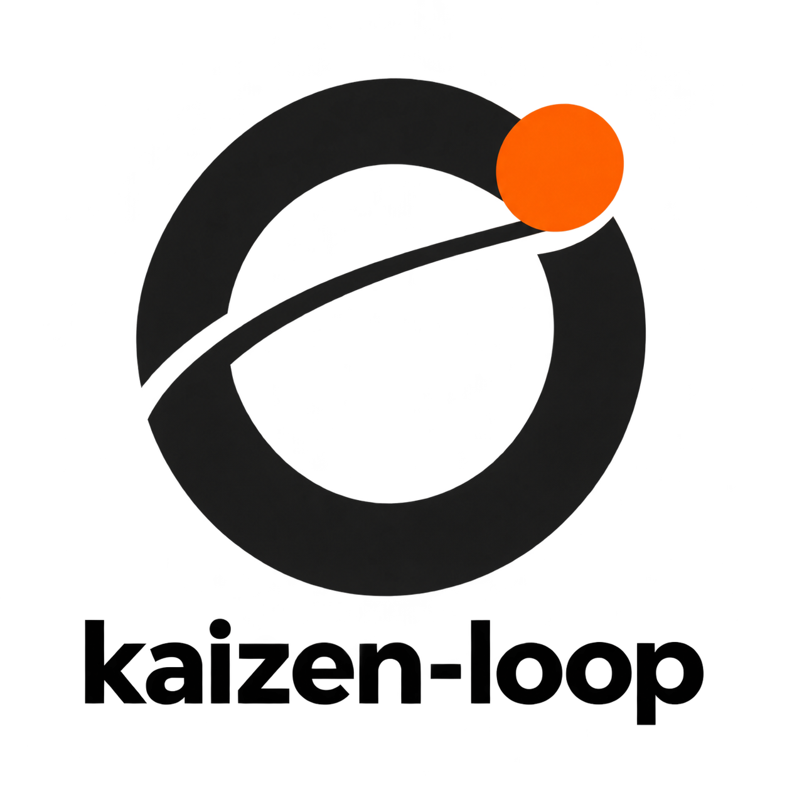

  

# kaizen-loop

Self-improvement loops for coding agents, with cheap local decision models in the loop.

kaizen-loop records each agent session, scores it against real signals (tests, PR outcomes, measured waste), rewrites the agent's skills from that evidence, proves the rewrite on a fixed benchmark, and ships it through a pull request. Small local decision models take the bounded decisions (which model tier, what kind of failure) and improve from the same recorded outcomes.

**Status:** early development. Nothing is usable yet.

## Planned stages

1. **Record and score** — capture sessions locally (secrets redacted) and score them with tests plus a blind judge.
2. **Improvement loop** — propose one skill change at a time, gate it on a benchmark with a hidden half, open a PR with the before/after score, revert automatically if real-use scores drop.
3. **Decision models** — route tasks and triage failures with local open-source decision models, chosen by benchmark.

Claude Code is the first supported agent. The core is agent-neutral Python.

## Research

The literature and engineering review behind the design is in [docs/research](docs/research/README.md).

## License

MIT
