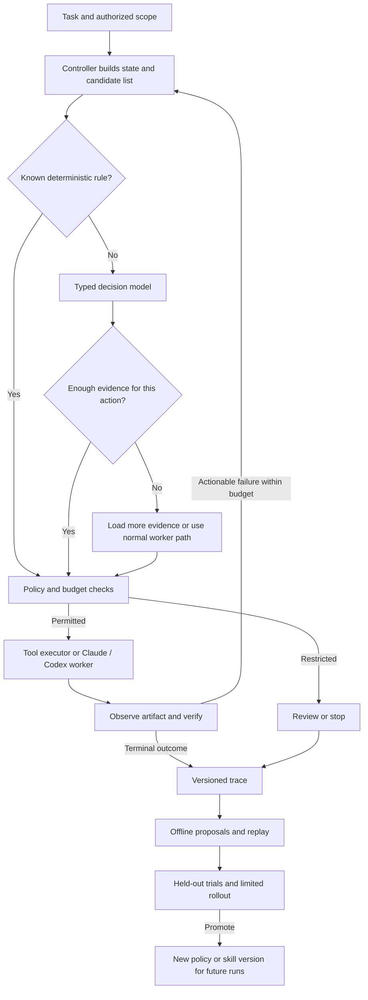

# Architecture for a self-improving coding agent with Jev-like decisions

Research date: November 20, 2026. This is a proposed architecture for a shared Claude Code and Codex controller. The strongest initial deployment is a read-only selector that decides which optional evidence or skill to load. It has a bounded answer space, a cheap fallback, and an observable cost. Add semantic guardrail decisions at tool boundaries where the runtime can enforce the outcome. Update the selector, lesson library, and tools offline from verified outcomes. [TypeSafe coding-agent guide](https://docs.typesafe.ai/introduction/coding-agents) · [Decision thresholds and measurement](09-decision-policy-and-evaluation.md)

## Three loops with different clocks

| Loop | Trigger and lifetime | What changes | Success criterion |
| --- | --- | --- | --- |
| Execution | Every task and tool result | Current patch, evidence, remaining budget | Independent acceptance check passes on the resulting artifact |
| Learning | A batch of completed, failed, interrupted and escalated runs | Candidate skill, retrieval rule, question wording, calibration or model weights | Fresh tasks improve relative to a frozen baseline under the same budget |
| Release | A candidate passes offline evaluation | Versioned production configuration for future runs | Limited rollout sustains quality, cost and guardrail bounds with a known rollback target |

A retry can improve one patch without improving future performance. A lesson can improve future work while costing tokens on every run where it is irrelevant. A release boundary makes both effects measurable. Reflexion provides a precedent for carrying experience into retries, Agent Workflow Memory for inducing reusable procedures, and GEPA for optimizing prompts using trace-level feedback. [Reflexion](https://arxiv.org/abs/2303.11366) · [Agent Workflow Memory](https://arxiv.org/abs/2409.07429) · [GEPA](https://arxiv.org/abs/2507.19457)

## What the controller owns

**Task state.** Persist the task ID, repository and base revision, explicit objective, acceptance checks, authorized capabilities, attempt count, budget, and immutable artifact references. During execution add compact observations such as failed test IDs, changed paths and the worker's proposed action. Separate trusted runtime facts from claims inside logs or retrieved documents. If a branch needs a file path or numerical result, carry the exact value together with its source. Preserve the underlying artifact so a worker can reopen it after compaction.

**Decision contract.** Each question has a stable ID, version, input fields, closed option set or rubric, and fallback. Record candidate order and definitions as well as the selected option. Changing “repair” to “repair if tests failed” changes the meaning of historical scores. Include an explicit abstention path when a correct option can be missing. For a forced choice, TypeSafe also documents a companion question asking whether any option fits. The two answers can be correlated. [TypeSafe primitives](https://docs.typesafe.ai/primitives) · [Companion Noul](https://docs.typesafe.ai/patterns/companion-noul)

**Authority and execution.** The controller constructs the legal action set using actual permissions and budgets. A decision returns an identifier or score. The executor maps the identifier to a predeclared operation and validates its concrete arguments. Recheck scope immediately before execution. Persist an operation ID before a side effect and reconcile its observed result before retrying after a timeout. A timeout can mean that the action completed and the acknowledgement was lost.

**Verifier.** Keep task completion separate from worker exit status and model verdict. Grade the patch in a clean environment using fixed acceptance fixtures. Distinguish a functional failure from a broken test environment, timeout and inconclusive result. For subjective outputs, use a rubric plus periodically double-scored human examples. Blind graders to candidate identity and track disagreements by failure type. [Anthropic agent evals](https://www.anthropic.com/research/demystifying-evals-for-ai-agents)

## Placement of decision calls

| Decision point | Evidence and question | Action, fallback and learning signal |
| --- | --- | --- |
| Before a worker call | Task, supported runbooks, current repo capabilities. Choice among an existing mechanical procedure, coding worker, or request for more context | A known procedure may run directly within scope. Unknown tasks take the standard worker path. Label from verified completion and actual escalation |
| Before loading a skill | Short task and candidate skill descriptors. Does any skill apply, and which one? | Load only the selected body. On ambiguity use ordinary discovery. Measure missing skills, erroneous loads and downstream solved tasks |
| Before a large file or log read | Current failure, file outline, candidate spans. Which spans bear on this failure? | Supply exact spans with paths and an expand operation. Track re-reads, omitted dependencies, and full-task token usage |
| Before a tool action | User scope, normalized target, capability and proposed arguments. Does this action satisfy a specific semantic policy criterion? | The executor applies binding policy. Ambiguous protected operations wait for independent review. Label from policy adjudication, including benign actions that were interrupted |
| After a failed verifier | Exact failure, last intervention and environment status. Which failure category best explains the observation? | Choose targeted repair, environment recovery, or stop. Check whether the next attempt resolves the observed failure and passes regressions |
| After successful or failed runs | Paired traces and recurring failure clusters. Does this observation merit a candidate lesson? | Queue proposals for offline evaluation. A model score can prioritize that queue. Held-out improvements determine promotion |

Routing within a worker's ongoing turn can save future reads. Routing before dispatch can avoid an entire worker call. When using an ordinary CLI wrapper, the controller directly owns dispatch and post-run verification. Per-tool enforcement requires a supported pre-execution hook or a mediated tool executor covering every relevant path. A wrapper reading event logs after execution is an audit mechanism. Validate these integration points per client and installed version. [Claude Code hooks](https://code.claude.com/docs/en/hooks) · [Codex hooks](https://learn.chatgpt.com/docs/hooks) · [Codex non-interactive mode](https://learn.chatgpt.com/docs/non-interactive-mode)

## A concrete execution trace

Consider a worker fixing a CSV exporter that drops leading zeroes in account identifiers. The task authorizes edits and local testing. The controller retrieves descriptors for CSV serialization, schema migrations, and snapshot testing. A Choice plus a fit question select CSV serialization. The worker receives the CSV skill and a pointer to the failing fixture. It proposes a code change and a focused test. Trusted checks validate the working directory and test profile. The test passes on the fixture, but a regression test fails on empty fields. The verifier returns the failing case, the actual value, and a pointer to the full output. The worker revises the patch within its retry budget. The controller reruns both checks and records the final diff and outcome.

Suppose production traces show that the selector repeatedly loads the migration guide when an issue contains “schema” even though it only changes exported formatting. The learning loop proposes adding a scope example to the migration descriptor. Its evaluation set includes actual migrations and similarly worded serialization tasks. The candidate ships only if fewer unnecessary loads outweigh losses on real migrations within the quality margin. Persist success and failure examples separately so the next optimizer can discover when the new descriptor is too narrow. This is an illustrative trace.

## How the learning loop changes the system

1. **Capture decision opportunities.** Include no-op decisions, escalations, rejected tool requests, and failed runs. A log containing only successful automatic routes makes the policy appear better calibrated than it is.
2. **Attribute the failure.** Inspect the earliest decision where a feasible alternative had evidence of helping. If the correct skill was missing from retrieval, changing the selector threshold cannot recover it. If it was present but scored low, inspect wording, calibration, and distribution shift. If selection was correct but the worker ignored it, examine the worker interface.
3. **Propose the smallest change with a falsifiable prediction.** A bad name calls for a descriptor edit. Repeated deterministic formatting errors may call for a test or script. A generalizable semantic distinction with many labeled examples may justify training a readout. Keep the candidate diff, baseline version, examples, expected effect, cost, and counterexamples.
4. **Replay cheaply, then rerun end to end.** Static replay can reveal whether the candidate selects better actions given the original observations. Changing the first action changes later observations, so use fresh independent checkouts and full worker runs for the final comparison. Hold the worker model and budget fixed.
5. **Promote, retire, and roll back.** Publish a versioned bundle of candidates, descriptors, decision prompts, calibration parameters and thresholds. Pin each active task to one bundle. If a candidate increases interruptions or re-reads, route new tasks back to the previously accepted bundle. Index lessons by applicability and observed reuse. Archive obsolete entries to avoid paying for stale instructions.

Agentic Context Engineering studies incremental playbook updates. GEPA searches candidate prompt changes across trajectories. DGM broadens search to executable harness variants. These are different levels of intervention, each requiring its own regression budget. A repository-context study found higher inference costs and no overall success gain in its evaluation, which makes unconditional lesson accumulation a poor default. [ACE](https://arxiv.org/abs/2510.04618) · [GEPA](https://arxiv.org/abs/2507.19457) · [DGM](https://arxiv.org/abs/2505.22954) · [Evaluating AGENTS.md](https://arxiv.org/abs/2602.11988)

## Designing a Jev-like local model

Start with the same decision interface for hosted Jev, a local text classifier, and a generative baseline. Each adapter accepts a compact state, a versioned question, and candidate definitions. It returns typed values, scores if available, model version, and measured usage or local runtime. Treat malformed results, unavailable models, and unsupported primitives as explicit fallback events.

For a local Choice model, a simple starting architecture encodes task state and candidate descriptions, scores each candidate, then normalizes over the allowed set. Train using labeled choices and hard negatives drawn from confusing sibling skills. Include tasks where no candidate fits, randomize candidate order during training and evaluation, and split by repository or time before mining negatives. Train binary heads for independent policy questions and an ordinal output for rubric levels if those are required. If multiple skills can be correct, use multi-label targets or accept equivalent choices during evaluation. A single forced gold label encourages overconfidence on interchangeable options.

Freeze the base encoder first and evaluate a small readout. Compare its label accuracy, calibration, serving cost and downstream utility with fine-tuning the encoder. Benchmark the actual hardware across short and long states, cold start, warm serving and concurrency. Jev's proprietary internals are unpublished. This is an open implementation design. A controlled preprint found similar in-domain accuracy for five readouts on one 0.6B backbone under a shared recipe, with a simpler head faster than a larger comparison in that setup. [Small Heads, Strong Decisions](https://arxiv.org/abs/2611.15592) · [Cloudflare's Clef implementation account](https://blog.cloudflare.com/clef-decision-models/) · [TypeSafe generative comparison adapter](https://github.com/typesafe-ai/system-one-adapter-python)
